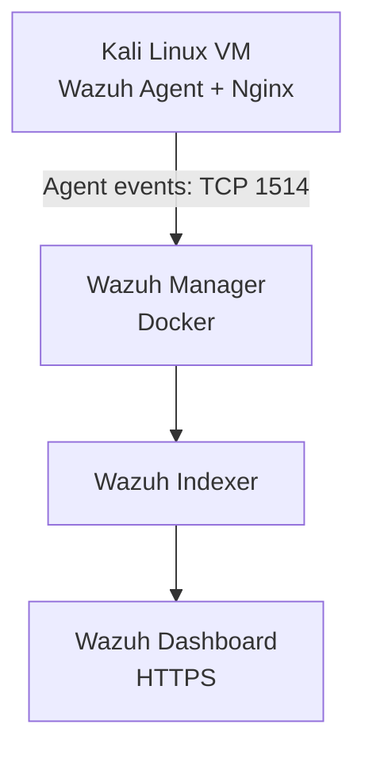
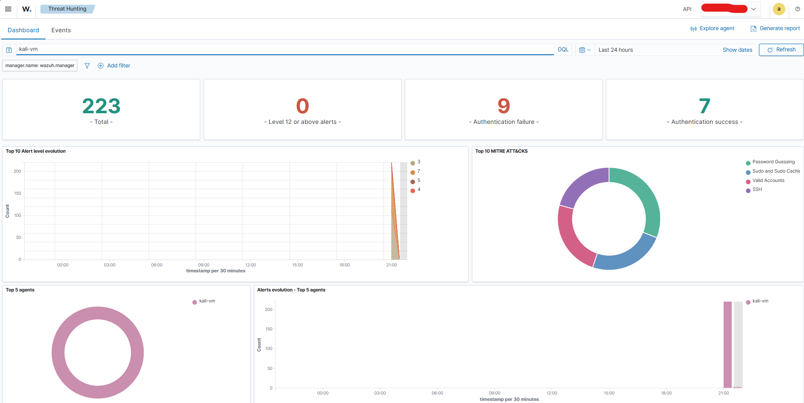
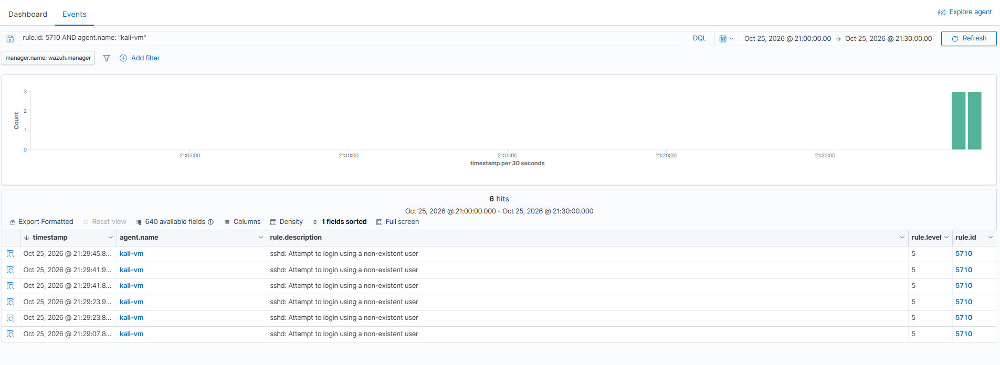
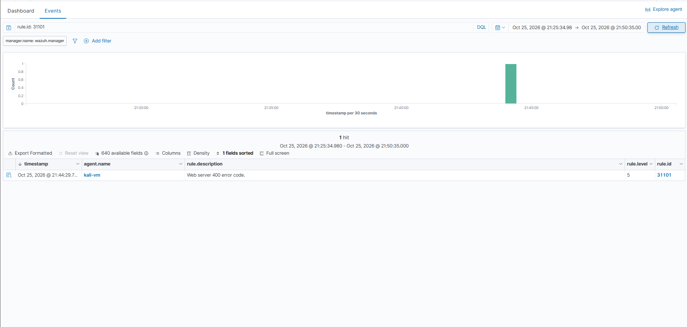

# Wazuh Mini-SOC Lab

A hands-on Security Operations Center (SOC) home lab built to practise endpoint monitoring, log analysis, security alert triage, and incident documentation using Wazuh and Kali Linux.

## Project Overview

This project demonstrates a small, isolated SOC monitoring environment. A Kali Linux virtual machine runs the Wazuh agent and Nginx. Wazuh collects and analyses events, generates alerts, and displays them in the dashboard for investigation.

**Project status:** Core lab deployment and two detection-validation exercises completed.

## Lab Architecture

### Environment

- **Host OS:** Windows 11
- **Virtualisation:** VMware with Kali Linux
- **Container platform:** Docker Desktop with WSL2
- **SIEM / endpoint monitoring:** Wazuh 4.14.9
- **Web server used for testing:** Nginx
- **Investigation interface:** Wazuh Dashboard

## Detection Validation

### 1. SSH Authentication Failures

**Objective:** Validate that failed SSH authentication activity on the monitored endpoint is collected and generates Wazuh alerts.

- Generated three controlled SSH login attempts using nonexistent usernames against the Kali VM's loopback address.
- Observed corresponding SSH and PAM authentication-failure log entries.
- Confirmed Wazuh alerts for rule `5710` — nonexistent-user SSH login attempt — and rule `5503` — PAM login failure.
- Viewed the matching SSH events in the Wazuh dashboard.

**MITRE ATT&CK context:** Wazuh rule metadata associates the SSH detection with password guessing and SSH-related activity. The test was local and controlled; it does not demonstrate a successful compromise or remote attack.

### 2. Nginx Web Access Logging

**Objective:** Validate web access-log collection and alert generation for an HTTP error response.

- Started Nginx on the Kali VM.
- Requested the local root path and received HTTP `200`.
- Requested a deliberately nonexistent path and received HTTP `404`.
- Verified the corresponding entries in the Nginx access log.
- Confirmed Wazuh generated rule `31101` for the test event and that the event was visible in Threat Hunting.

The event used a local source address (`127.0.0.1`). This validates basic log collection, parsing, alert generation, and dashboard visibility; it does not establish exploit detection.

**Rule-tuning observation:** The generated rule description refers to a “400 error code,” while the recorded test response was HTTP `404`. This discrepancy is documented for further rule-review rather than treated as proof of malicious activity.

## Incident Documentation

| Reference | Scenario | Documentation |
|---|---|---|
| INC-001 | SSH authentication failures | `documentation/incidents/INC-001-ssh-auth-failures.md` |
| INC-002 | Nginx HTTP 404 alert | `documentation/incidents/INC-002-web-request-alert.md` |

## Standard Operating Procedures

- `documentation/sops/SOP-001-ssh-authentication-failures.md`
- `documentation/sops/SOP-002-suspicious-web-requests.md`

The SOPs cover initial triage, evidence collection, investigation, escalation considerations, and closure documentation.

## Skills Practised

- SIEM deployment and basic administration
- Linux endpoint onboarding and agent connectivity verification
- Authentication-log analysis
- Web access-log analysis
- Alert investigation and rule identification
- Incident-ticket and SOP documentation
- Basic mapping to MITRE ATT&CK using Wazuh rule metadata

## Limitations and Next Steps

This is a small home lab, not a production SOC environment. The tests are controlled and primarily local. They do not demonstrate automated response, attack prevention, production-scale monitoring, or comprehensive detection coverage.

Potential improvements:

1. Add more controlled detection tests, such as repeated failed logins from a separate authorised lab host.
2. Review the web rule's status-code interpretation and test additional HTTP response codes.
3. Add timestamped evidence and concise investigation notes to each incident.
4. Document detection limitations and false-positive considerations.
5. Add further endpoints and validate agent health and event ingestion.

## Security and Privacy

This repository is intended to contain documentation and sanitised screenshots only. Do not commit private keys, certificates containing sensitive material, credentials, API tokens, `.env` files, raw sensitive logs, or the full deployment configuration without reviewing it for secrets.

Keep the lab isolated and do not expose its management ports to the public internet.

## Summary

This project demonstrates practical introductory SOC workflows: onboarding a monitored endpoint, validating authentication and web-log detections, investigating alerts in Wazuh, and documenting incidents and response procedures.